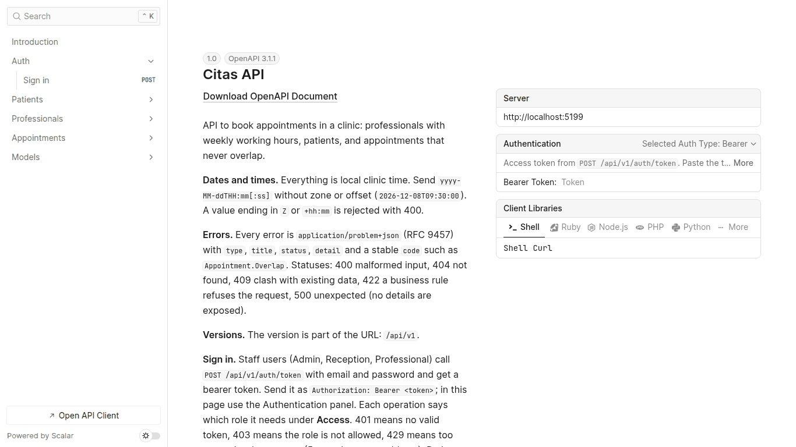
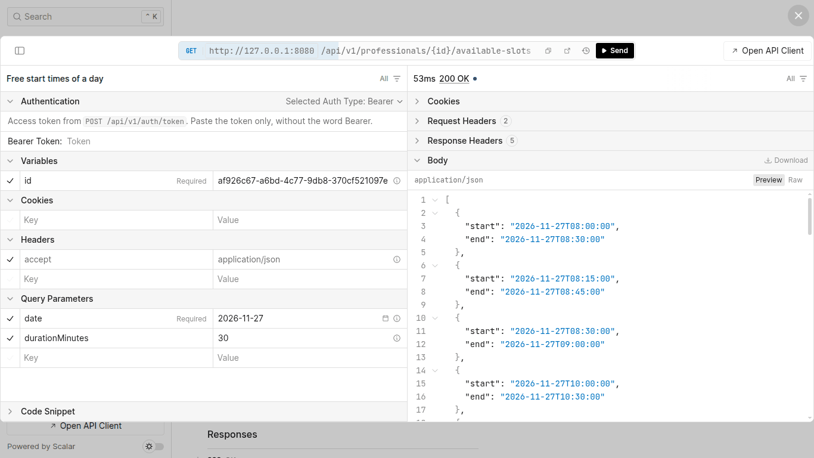
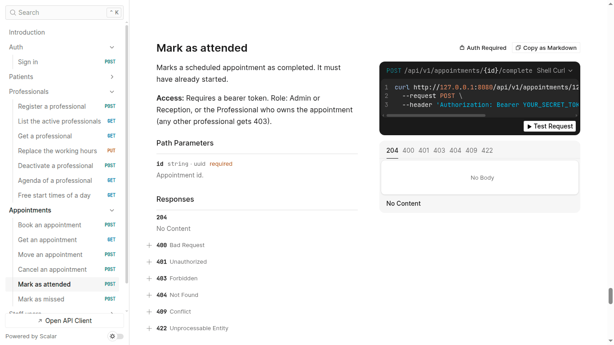
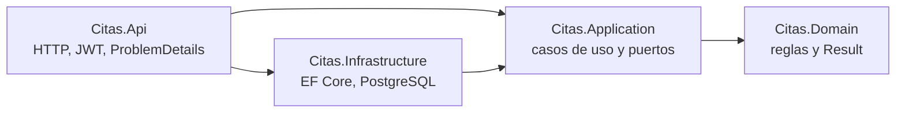

# Citas API

API para reservar citas en un consultorio, con .NET 10 y PostgreSQL.

[](https://github.com/jhondiazbotero/citas-api-dotnet/actions/workflows/ci.yml)

[](LICENSE)

## Qué resuelve

Un consultorio tiene profesionales con horarios semanales y pacientes que piden citas. La API se encarga de que:

- Cada profesional tenga su agenda, con las horas en las que atiende.
- Nadie pueda reservar la misma hora dos veces, ni siquiera si dos personas lo intentan en el mismo instante.
- Un paciente cancele con al menos 24 horas de anticipación. El consultorio puede cancelar hasta que la cita empiece.
- El público consulte los horarios libres de un profesional sin iniciar sesión.
- El personal (administración, recepción y los profesionales) vea y gestione solo lo que le corresponde.

## Lo que muestra este proyecto

- Reglas de negocio en el dominio, sin excepciones: cada regla devuelve un `Result` con un error de código estable. Ver [`src/Citas.Domain`](src/Citas.Domain) y el [ADR 0002](docs/adr/0002-patron-result-en-lugar-de-excepciones.md).
- Una restricción de exclusión de PostgreSQL que impide dos citas cruzadas aunque lleguen a la vez, con la prueba de carrera real contra la base. Ver la [migración inicial](src/Citas.Infrastructure/Persistence/Migrations/20261125182054_InitialCreate.cs) y [`UnitOfWorkTests`](tests/Citas.Infrastructure.Tests/UnitOfWorkTests.cs).
- Clean Architecture con cuatro proyectos, y las reglas de dependencia comprobadas por pruebas de arquitectura. Ver [`DependencyRulesTests`](tests/Citas.Architecture.Tests/DependencyRulesTests.cs).
- Pruebas de integración contra PostgreSQL real levantado con Testcontainers. Ver [`PostgresFixture`](tests/Citas.Testing/PostgresFixture.cs).
- Seguridad con JWT, tres roles y permisos por recurso (un profesional solo ve su agenda y sus citas). Ver [`src/Citas.Api/Security`](src/Citas.Api/Security).
- Errores con ProblemDetails (RFC 9457) y un campo `code` estable que el cliente puede usar. Ver [`ErrorStatus`](src/Citas.Api/Http/ErrorStatus.cs).
- CI con pruebas y cobertura. Ver [`ci.yml`](.github/workflows/ci.yml).

## Vista previa

La documentación interactiva queda en `/docs`. Ahí se ven los endpoints, quién puede usar cada uno y se pueden probar con el token.







## Arquitectura

Las dependencias apuntan hacia adentro. El dominio no conoce a nadie, y `Citas.Api` es el único proyecto que ve a los otros tres para armarlos.



| Proyecto | Qué vive ahí |
|---|---|
| `Citas.Domain` | Profesionales, pacientes, citas, usuarios del personal, el servicio `AppointmentScheduler` con las reglas de agendamiento, `Result`, `Error` y los catálogos de errores. |
| `Citas.Application` | Un manejador por caso de uso (15 en total), validación con FluentValidation y las interfaces que implementa infraestructura (repositorios, reloj, hash de contraseñas, emisor de tokens). |
| `Citas.Infrastructure` | EF Core con PostgreSQL, configuraciones, migraciones, repositorios, hash de contraseñas, reloj del consultorio y datos de demo. |
| `Citas.Api` | Minimal APIs, versionado `/api/v1`, autenticación y políticas, ProblemDetails, OpenAPI con Scalar, health checks y logs con Serilog. |

Las pruebas están en `tests/`: un proyecto por capa, `Citas.Architecture.Tests` y `Citas.Testing` (la base de datos compartida).

## Reglas de negocio

El estado HTTP lo decide `ErrorStatus.For` a partir del código del error. Estas son las reglas que el negocio puede notar:

| Regla | Código de error | Estado |
|---|---|---|
| Un profesional no puede tener dos citas agendadas a la misma hora | `Appointment.Overlap` | 409 |
| Un paciente no puede tener dos citas agendadas a la misma hora | `Appointment.PatientOverlap` | 409 |
| La cita debe empezar con al menos 1 hora de anticipación | `Appointment.TooSoon` | 422 |
| La cita no puede empezar en el pasado | `Appointment.InThePast` | 422 |
| La cita debe caer dentro del horario del profesional | `Appointment.OutsideWorkingHours` | 422 |
| El profesional debe estar activo | `Professional.Inactive` | 422 |
| El paciente cancela con al menos 24 horas de anticipación | `Appointment.CancellationTooLate` | 422 |
| Reprogramar pide 24 horas antes de la hora original | `Appointment.RescheduleTooLate` | 422 |
| El consultorio no puede cancelar una cita que ya empezó | `Appointment.AlreadyStarted` | 422 |
| Solo una cita agendada puede cambiar de estado | `Appointment.NotScheduled` | 422 |
| Completar o marcar inasistencia exige que la cita ya haya empezado | `Appointment.NotStartedYet` | 422 |
| Dos personas cambian la misma cita a la vez | `Appointment.ConcurrencyConflict` | 409 |
| El documento de un paciente es único | `Patient.DuplicateDocument` | 409 |
| Un profesional necesita al menos una franja y las de un mismo día no se cruzan | `Professional.NoWorkingHours`, `Professional.OverlappingWorkingHours` | 422 |
| Duración de 15 a 120 minutos en pasos de 15, inicio en minuto 0, 15, 30 o 45 | `TimeRange.InvalidDuration`, `TimeRange.InvalidStart` | 400 |
| Algo que no existe | `Appointment.NotFound`, `Patient.NotFound`, `Professional.NotFound` | 404 |
| Correo o contraseña incorrectos (siempre el mismo mensaje) | `Auth.InvalidCredentials` | 401 |
| Más de 5 intentos de inicio de sesión por minuto desde una dirección | `Auth.TooManyAttempts` | 429 |
| El rol no permite la acción | `Auth.Forbidden` | 403 |

Los datos mal formados (nombres, teléfonos, cuerpos que no son JSON, fechas con zona) dan 400, con códigos como `Patient.InvalidName` o `Request.InvalidDateTime`. Todas las respuestas de error son ProblemDetails con los campos `type`, `title`, `status` y `detail`, más el `code`:

```json
{
  "status": 409,
  "detail": "The professional already has an appointment at that time.",
  "code": "Appointment.Overlap"
}
```

## Endpoints

Todos cuelgan de `/api/v1`. La documentación interactiva está en `/docs`. «Personal» es cualquier usuario con sesión.

| Método | Ruta | Quién puede usarlo |
|---|---|---|
| POST | `/auth/token` | Cualquiera (5 intentos por minuto por dirección) |
| POST | `/patients` | Admin o Reception |
| GET | `/patients/{id}` | Admin o Reception |
| POST | `/professionals` | Admin |
| GET | `/professionals/{id}` | Personal |
| PUT | `/professionals/{id}/working-hours` | Admin |
| POST | `/professionals/{id}/deactivate` | Admin |
| GET | `/professionals/{id}/agenda?from=&to=` | Admin o Reception, o el mismo profesional |
| GET | `/professionals/{id}/available-slots?date=&durationMinutes=` | Cualquiera, sin sesión |
| POST | `/appointments` | Admin o Reception |
| GET | `/appointments/{id}` | Admin o Reception |
| POST | `/appointments/{id}/reschedule` | Admin o Reception |
| POST | `/appointments/{id}/cancel` | Admin o Reception |
| POST | `/appointments/{id}/complete` | Admin o Reception, o el profesional dueño de la cita |
| POST | `/appointments/{id}/no-show` | Admin o Reception, o el profesional dueño de la cita |

Fuera de `/api/v1`: `GET /health/live`, `GET /health/ready` (503 si no llega a la base) y `GET /health`, sin sesión.

Las horas van en la hora local del consultorio, sin zona (`2026-12-01T09:30`). Un valor con `Z` o con desfase se rechaza. Ver el [ADR 0004](docs/adr/0004-hora-local-del-consultorio-sin-zona.md).

## Cómo correrlo

### Con Docker

Necesitas Docker con Compose.

```bash
cp .env.example .env
openssl rand -base64 48        # pega el resultado en JWT_SIGNING_KEY dentro de .env
```

En `.env` también hay que llenar `POSTGRES_PASSWORD` (solo letras y números) y `DEMO_USERS_PASSWORD` (la contraseña de los usuarios de demo, la que quieras). Después:

```bash
docker compose up -d --build
```

Abre http://localhost:8080/docs. Inicia sesión con `POST /api/v1/auth/token` usando `admin@demo.local` y la contraseña que pusiste en `DEMO_USERS_PASSWORD`, y pega el token en el panel de autenticación Bearer de Scalar. Además del administrador hay un usuario de recepción (`recepcion@demo.local`) y uno por cada profesional de demo (por ejemplo `marquina@demo.local`), todos con esa misma contraseña.

El compose arranca la API en modo producción, con las migraciones aplicadas y los datos de demo (3 profesionales, 5 pacientes y 6 citas). Para apagar todo y borrar la base: `docker compose down -v`.

### Sin Docker

Necesitas el SDK de .NET 10 y un PostgreSQL al que puedas conectarte, con una base vacía llamada `citas`. La cadena de conexión, la llave y la contraseña de demo van en `user-secrets`, nunca en un archivo versionado:

```bash
dotnet user-secrets set "ConnectionStrings:Citas" "Host=localhost;Port=5432;Database=citas;Username=TU_USUARIO;Password=TU_CLAVE" --project src/Citas.Api
dotnet user-secrets set "Jwt:SigningKey" "$(openssl rand -base64 48)" --project src/Citas.Api
dotnet user-secrets set "Demo:UsersPassword" "UNA_CLAVE_LARGA" --project src/Citas.Api
dotnet run --project src/Citas.Api
```

En Development la API aplica las migraciones y carga los datos de demo al arrancar. Queda en http://localhost:5108/docs.

### Ejemplo con curl

Pide el token (cambia la contraseña por la de `DEMO_USERS_PASSWORD`):

```bash
curl -s http://localhost:8080/api/v1/auth/token \
  -H 'Content-Type: application/json' \
  -d '{"email":"admin@demo.local","password":"LA_CLAVE_DE_DEMO"}'
```

```json
{
  "accessToken": "eyJhbGciOiJIUzI1...",
  "expiresAt": "2026-11-25T23:15:03.5685535+00:00",
  "role": "Admin"
}
```

Los horarios libres de un día no piden sesión. El `id` del profesional sale de la agenda o de la base de demo:

```bash
curl -s "http://localhost:8080/api/v1/professionals/ID_DEL_PROFESIONAL/available-slots?date=2026-11-27&durationMinutes=30"
```

```json
[
  { "start": "2026-11-27T08:00:00", "end": "2026-11-27T08:30:00" },
  { "start": "2026-11-27T08:15:00", "end": "2026-11-27T08:45:00" },
  { "start": "2026-11-27T08:30:00", "end": "2026-11-27T09:00:00" }
]
```

Salida real recortada: ese día la profesional de demo tenía 25 horarios libres de 30 minutos.

### Detrás de un proxy

El límite de intentos de inicio de sesión cuenta por la dirección IP de la conexión. Por defecto la API **no** lee `X-Forwarded-For` (`ForwardedHeaders__Enabled=false`): sin un proxy delante, cualquiera podría escribir esa cabecera y cambiar de dirección en cada petición para esquivar el límite. Por eso ni el `Dockerfile` ni el `docker-compose.yml` la encienden.

Se enciende solo cuando la API queda detrás de un proxy inverso que pone la cabecera, con `ForwardedHeaders__Enabled=true`. Sin esa variable, detrás de un proxy todos los clientes comparten una sola dirección (la del proxy) y también una sola cuota. Con ella, la API cree solo la última entrada de la cabecera, la que agrega el proxy más cercano, y la API no debe ser alcanzable sin pasar por él. Más en el [ADR 0006](docs/adr/0006-jwt-sin-refresh-tokens-y-usuarios-del-personal.md).

## Pruebas

Las pruebas de infraestructura y de la API levantan PostgreSQL con Testcontainers, así que necesitan Docker en marcha.

```bash
dotnet test CitasApi.slnx -c Release \
  --collect:"XPlat Code Coverage" --settings coverage.runsettings \
  --results-directory ./TestResults
```

Medido el 25 de noviembre de 2026 con ese comando: 687 pruebas, todas en verde.

| Proyecto de pruebas | Pruebas | Qué cubre |
|---|---|---|
| `Citas.Domain.Tests` | 231 | Reglas del dominio, sin base de datos |
| `Citas.Application.Tests` | 125 | Casos de uso con repositorios falsos |
| `Citas.Architecture.Tests` | 8 | Reglas de dependencia entre capas y ningún secreto en archivos versionados |
| `Citas.Infrastructure.Tests` | 73 | EF Core y las restricciones contra PostgreSQL real |
| `Citas.Api.Tests` | 250 | La API completa por HTTP con PostgreSQL real, incluida la matriz de permisos por rol |

Cobertura de `src/` (sin pruebas, migraciones ni código generado): 99 % de líneas (1718 de 1734) y 94,6 % de ramas (462 de 488).

## Decisiones

- [0001](docs/adr/0001-clean-architecture-con-cuatro-proyectos.md): Clean Architecture con cuatro proyectos y pruebas de arquitectura.
- [0002](docs/adr/0002-patron-result-en-lugar-de-excepciones.md): `Result` en lugar de excepciones para las reglas de negocio.
- [0003](docs/adr/0003-restriccion-de-exclusion-en-postgresql.md): restricción de exclusión en PostgreSQL contra reservas simultáneas.
- [0004](docs/adr/0004-hora-local-del-consultorio-sin-zona.md): hora local del consultorio, sin zona, en la API.
- [0005](docs/adr/0005-minimal-apis-con-manejadores-propios.md): Minimal APIs con handlers propios, sin MediatR.
- [0006](docs/adr/0006-jwt-sin-refresh-tokens-y-usuarios-del-personal.md): JWT sin refresh tokens y usuarios solo del personal, con sus límites.

## English summary

Citas API is a REST API to book appointments at a clinic, built with .NET 10 and PostgreSQL. Business rules (no double booking, 24-hour patient cancellation, working hours) live in the domain and return a `Result` instead of throwing. A PostgreSQL exclusion constraint also rejects overlapping bookings that arrive at the same moment, and an integration test runs that race against a real database.

The code follows Clean Architecture in four projects, and architecture tests fail the build if a layer depends on one it should not. Security uses JWT with three staff roles and per-resource permissions. Errors are RFC 9457 problem details with a stable `code` field.

To run it: copy `.env.example` to `.env`, fill in the three values (`openssl rand -base64 48` for the signing key), then `docker compose up -d --build` and open http://localhost:8080/docs. Sign in as `admin@demo.local` with the password you set in `DEMO_USERS_PASSWORD`. Tests need Docker (Testcontainers). The decision records are in `docs/adr`, in Spanish.

## Licencia y autor

MIT, ver [LICENSE](LICENSE).

Jhon Díaz Botero: [sitio web](https://jhondiazbotero.github.io), [GitHub](https://github.com/jhondiazbotero) y [LinkedIn](https://www.linkedin.com/in/jhon-bayron-diaz-botero-45a5951b8).
